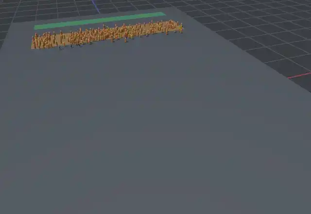
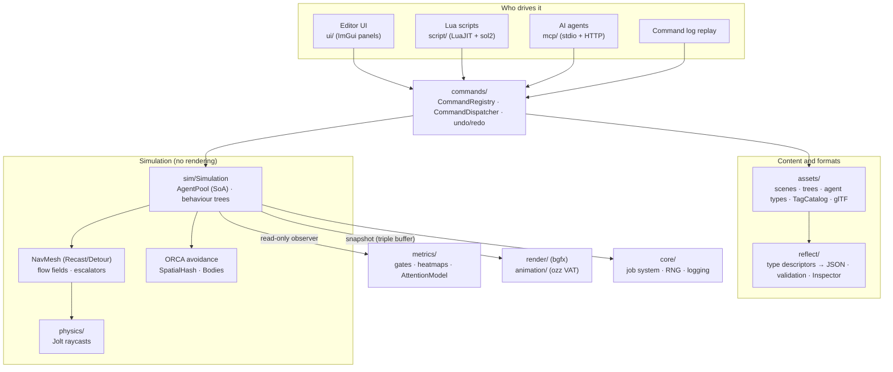

<div align="center">

# CrowdSim

**A real-time 3D crowd simulator and editor in C++20. Every venue, population and scenario is
built from data, and the engine stays generic.**




<sub>5,000 agents in two opposing streams form lanes as they pass. Recorded from the editor's 3D
view with <code>crowdsim --scenario counterflow --agents 5000 --sim-speed 4 --record out.avi</code>
on an i7-13700H laptop. The simulation runs at 4× speed.</sub>

</div>

- **50,000 agents in 15 ms per step** on a 20-thread laptop CPU, with deterministic results:
  the same seed gives the same crowd on any thread count.
- **Behaviour trees as content.** 33 node types, a node-graph editor, hot reload, and Lua
  custom nodes. Whether a person walks or stands on an escalator, queues or pushes, or looks
  at their phone is a tree parameter, not engine code.
- **Physical mechanics:** multi-storey navmeshes, escalators and travelators, queues, body
  contact with crowd pressure and falls, emergency-only routes, and a visual-attention model.
- **Drivable by people, scripts and AI agents.** Every edit is a command, so the GUI, Lua, an
  MCP server (41 tools) and replay logs all share one undoable path.
- **Studies built from content:** escalator etiquette, an MRT travelator tunnel with ad stands,
  a four-storey mall with fire stairs, and the Itaewon 2022 crowd crush with three
  counterfactual layouts.

## Highlights

**Mechanics in the engine; behaviour and scenarios in content.** The engine never branches on
a scene, object or agent-type name. An escalator is an object tagged `escalator`, and whether
a rider stands left or walks right is `SetEscalatorStyle {side, walk, clear}` in that rider's
behaviour tree. The rule is written down in [CLAUDE.md](CLAUDE.md), and the scenario scenes
show it holds: none of them needed scenario-specific engine code.

**Deterministic and parallel at the same time.** Locomotion runs on a job system. Shared state
(queues, arrivals, spawns) is resolved in serial passes. Each agent has its own seeded RNG.
Every 64 steps the agent pool is reordered by Z-order of 2.5 m cells, with ties broken by id,
so neighbours sit together in memory. That cut avoidance time by 30 % without changing a
single result ([ADR 0013](docs/decisions/0013-scale-up-and-gpu-locomotion.md)). A CTest entry
checks that two thread counts produce identical state hashes.

**One command layer for every caller.** The editor, Lua scripts, the MCP server and replays
all issue the same JSON commands through one dispatcher with undo and redo
([ADR 0006](docs/decisions/0006-command-layer.md)). A command log replays to an identical
result (`commands_replay_identical`). An AI client can build a hall, define two populations
with their own trees and run them headless (`mcp_stdio_workflow`).

**Reflection instead of hand-written glue.** Scene types are described once, next to the type,
with keys, limits, units and tooltips ([ADR 0014](docs/decisions/0014-reflection.md), with
magic_enum for enums). Saving, loading, validation messages such as
`area.halfExtents: must be above 0`, and the Inspector UI are generated from those
descriptors. Every scene and agent type in `content/` round-trips byte for byte, and a test
checks that.

**Crowd safety physics that stays stable.** With scene `bodies` enabled, agents push on each
other through soft contact springs, with a position-correcting core. This produces crowd
pressure (N/m) and falls when a crowd is packed tight. The integration is explicit at 30 Hz,
so contact is kept soft on purpose. The Itaewon study compares the 2022 layout with versions
that are one-way, metered, or have no temporary wall.

**Measuring what people see.** Objects tagged `attention` (ads, signs, exits) are scored by
glances, dwell time and viewer counts. The model uses a foveal cone, peripheral vision, head
turns, readable size and phone distraction, all set per agent by `SetAttention {phone,
interest}`. The editor can draw each agent's view cones. The scores are exported to CSV and
saved with the scene.

## Architecture

The simulation (`sim/`) has no rendering dependencies. The editor and the headless runner
are two thin executables composed in `app/` from the same modules. There are no singletons
or mutable globals ([ADR 0002](docs/decisions/0002-no-global-state.md)), and CI enforces this
with `tools/`.



One fixed 30 Hz step (`Simulation::step`), in the order the code runs it:

```mermaid
flowchart LR
    A["updateNavigation<br/>(flow fields)"] --> B["reorderAgents<br/>(every 64 steps)"]
    B --> C["spawnAgents"]
    C --> D["tickBehaviors<br/>parallel, staggered"]
    D --> E["resolveDecisions<br/>serial: queues, arrivals"]
    E --> F["preferred velocities<br/>escalator lanes"]
    F --> G["ORCA avoidance<br/>+ body contact"]
    G --> H["integrate"]
    H --> I["despawns"]
    I --> J["observers<br/>metrics · attention · Lua"]
```



| Dir | Contents |
|---|---|
| `core/` | logging, job system, RNG, IDs, hashing, fixed-step clock, triple buffer, MJPEG video writer |
| `reflect/` | type descriptors: JSON encode/decode, validation with field paths, editor metadata |
| `geometry/` | triangle meshes and primitives (box, ramp, stairs, plane) |
| `snapshot/` | plain data passed to render: render snapshots, baked character assets |
| `animation/` | procedural character, ozz-animation clip baking into a VAT, gait controller |
| `sim/` | agent pool, spawners/goals (EnTT), navmesh (Recast/Detour), flow fields, ORCA, bodies, escalators, behaviour trees, scenarios (no rendering dependencies) |
| `physics/` | Jolt static collision and raycasts behind `IPhysicsWorld` |
| `assets/` | scene JSON, scene reflection, tag catalogue, glTF import, asset library, behaviour/agent JSON, BT graph model |
| `commands/` | command registry, dispatcher, undo/redo, command log and replay |
| `script/` | sandboxed LuaJIT + sol2: script BT nodes, entity types, events, script commands |
| `mcp/` | Model Context Protocol server (stdio and HTTP) with tools and resources over commands |
| `metrics/` | gates, time series, time to goal, stuck detection, heatmaps, crowd pressure, attention, trajectory recording |
| `platform/` | SDL3 window and events |
| `render/` | bgfx renderer, ImGui backend, embedded shaders |
| `ui/` | ImGui editor panels: scene editor and Inspector, BT node editor, agent debugger, metrics, attention, script console |
| `app/` | composition root: GUI and headless executables, content hot reload |
| `content/` | scenes, behaviour trees, agent types, tag catalogue, Lua scripts and scenarios, command batches, models |
| `tests/` | doctest unit tests and headless smoke, determinism and scenario tests |
| `bench/` | Google Benchmark suite (sim step at 1k–50k agents) |
| `tools/` | CI checks (e.g. no mutable global state), MCP workflow test, scene generators |

The design decisions are in [docs/decisions/](docs/decisions/) (14 ADRs), and the milestone
history and earlier measurements are in [docs/STATUS.md](docs/STATUS.md).

## Performance

Measured with `crowdsim_bench --benchmark_repetitions=3` (median) on an Intel i7-13700H laptop
with 20 threads, in a Release build, with the editor open in the background. Laptop thermals
move these numbers by about ±30 % between runs. Quieter earlier runs are in
[STATUS.md](docs/STATUS.md): 5k agents in 1.2 ms and 50k in about 10 ms.

| Benchmark | Time per step | Note |
|---|---|---|
| `SimStep` 1,000 agents | 0.54 ms | |
| `SimStep` 5,000 agents | 2.0 ms | 6.4 ms on one thread |
| `SimStep` 20,000 agents | 8.0 ms | |
| `SimStep` 50,000 agents | 15.2 ms | under the 33 ms budget of a 30 Hz real-time step |
| `PlazaStep` 20,000 (behaviour trees) | 5.7 ms | about 9k alive on average |
| `GaitUpdate` 50,000 | 2.1 ms | animation state for every character |

**The bottleneck is avoidance.** `crowdsim_headless --scenario benchmark --agents 20000
--profile` spends 3.8 of its 6.5 ms per step in ORCA. The cost comes from memory access, not
arithmetic, which is why the spatial reordering helped. Behaviour trees cost 0.15 ms at 20k
because they tick at a low, staggered rate. In the editor the simulation still runs on the
render thread, so at 50k agents frame pacing follows the step. ADR 0013 designs a simulation
thread, GPU culling and a GPU-compute locomotion path for 200k+ agents.

## Testing

```bash
ctest --test-dir build/windows-msvc -C Release
```

- **109 doctest cases** (`crowdsim_tests`) cover:
  - navigation, ORCA, escalators, queues and bodies;
  - behaviour-tree compile errors;
  - commands and undo;
  - Lua sandboxing;
  - MCP protocol and tool schemas;
  - metrics and attention;
  - reflection round trips over every content scene and agent type;
  - a check that every tag used in content is catalogued.
- **9 CTest entries** run the real executables:
  - a headless smoke test and thread-count determinism;
  - scenarios where every agent must arrive or leave (stream, building, plaza);
  - a command-log replay that must match;
  - a GUI smoke test;
  - a Python MCP client that drives a full workflow over stdio.
- **CI** (`.github/workflows/ci.yml`) builds and tests Windows (MSVC), Linux (GCC) and macOS
  (Apple Clang), and checks for mutable global state with a script and with clang-tidy.

## Getting started

Requirements:
- CMake ≥ 3.25.
- A C++20 compiler: MSVC 19.4x+, GCC 13+, or Clang 17+ / Apple Clang 16+.
- Ninja (Linux/macOS).
- [vcpkg](https://github.com/microsoft/vcpkg) with `VCPKG_ROOT` set.

Dependencies are installed automatically from `vcpkg.json` on first configure. ozz-animation
is not in the vcpkg baseline, so CMake fetches it from its pinned 0.16.0 release.

```bash
# Windows (Visual Studio 2026)
cmake --preset windows-msvc
cmake --build build/windows-msvc --config Release
ctest --preset windows-msvc-release -LE gui

# Linux / macOS
cmake --preset linux        # or: macos
cmake --build build/linux --config Release
ctest --preset linux-release -LE gui

# Headless-only build (no SDL/bgfx/ImGui)
cmake --preset headless
```

Open a study in the editor (binaries are in `build/windows-msvc/bin/Release/`):

```bash
crowdsim --scene scenes/shopping_mall.scene.json
crowdsim --scene scenes/itaewon_2022.scene.json --overlays heatmap
crowdsim --scene scenes/travelator_tunnel.scene.json --overlays cones
crowdsim_headless --scene scenes/escalator_etiquette.scene.json --script scripts/escalator_trial.lua --steps 9000 --seed 1
```

Edit any `content/behaviours/*.bt.json`, agent type or tag file while the editor runs, and the
change is picked up immediately. `crowdsim_headless` prints a one-line JSON result on stdout
(logs go to stderr).

<details>
<summary><b>All run commands</b></summary>

```bash
build/windows-msvc/bin/Release/crowdsim                       # editor
build/windows-msvc/bin/Release/crowdsim --renderer vulkan     # pick a backend
build/windows-msvc/bin/Release/crowdsim_headless --scenario stream --agents 5000 --steps 2700
build/windows-msvc/bin/Release/crowdsim --scenario counterflow --agents 5000 --sim-speed 4
build/windows-msvc/bin/Release/crowdsim --scenario building --agents 2000 --overlays navmesh,flow
build/windows-msvc/bin/Release/crowdsim --scene scenes/two_floor_building.scene.json
build/windows-msvc/bin/Release/crowdsim --scenario plaza --agents 5000        # behaviour trees; click an agent to debug it
build/windows-msvc/bin/Release/crowdsim --scenario benchmark --lod 60,200 --no-vsync   # 5k animated characters
build/windows-msvc/bin/Release/crowdsim --script scenarios/kiosk_square.lua   # Lua: scripted kiosks + tourists
build/windows-msvc/bin/Release/crowdsim --scenario plaza --edit-bt wanderer    # behaviour tree node editor
build/windows-msvc/bin/Release/crowdsim_headless --mcp-stdio                   # MCP server for AI clients
build/windows-msvc/bin/Release/crowdsim --mcp-http 127.0.0.1:8765              # editor + MCP over HTTP
build/windows-msvc/bin/Release/crowdsim --script scenarios/bottleneck_study.lua --overlays heatmap,metrics
build/windows-msvc/bin/Release/crowdsim_headless --commands content/commands/build_corridor.commands.json --save-log run.cmdlog.json
build/windows-msvc/bin/Release/crowdsim_headless --replay run.cmdlog.json
build/windows-msvc/bin/Release/crowdsim_bench
build/windows-msvc/bin/Release/crowdsim_headless --scenario benchmark --agents 50000 --steps 600 --profile
build/windows-msvc/bin/Release/crowdsim --scene scenes/corridor_bottleneck.scene.json --record out.avi --record-seconds 20
build/windows-msvc/bin/Release/crowdsim --scene scenes/shopping_mall.scene.json --frames 600 --screenshot shot.png --camera 0,0,60,30,40
```

</details>

<details>
<summary><b>Documentation</b></summary>

- [docs/formats.md](docs/formats.md): scenes, behaviour trees and the node reference, agent
  types, the tag catalogue, attention targets, and the full command list.
- [docs/scripting.md](docs/scripting.md): the Lua API (custom nodes, entity types, events,
  reports).
- [docs/ai-integration.md](docs/ai-integration.md): connecting an AI client over MCP, tool
  conventions and a worked workflow. [docs/mcp.example.json](docs/mcp.example.json) is a
  ready-made client config.
- [docs/decisions/](docs/decisions/): ADRs 0001–0014.
- [CLAUDE.md](CLAUDE.md): where a change belongs (engine, behaviour node or content), plus
  build and verification habits.

</details>

<details>
<summary><b>Studies in <code>content/scenes</code></b></summary>

| Scene | What it studies |
|---|---|
| `corridor_bottleneck` | flow through a doorway: specific flow, queue density, time to goal |
| `two_floor_building` | stairs and ramps on a multi-level navmesh |
| `escalator_etiquette` | standers and walkers, keep-left lanes, boarding gaps (`scripts/escalator_trial.lua`) |
| `shopping_mall` | four storeys, escalators, shops, cinema, fire stairs and emergency exits (`scripts/mall_report.lua`) |
| `travelator_tunnel`, `travelator_tunnel_stands_facing_flow` | an MRT interchange tunnel with travelators and ad stands, scored by the attention model (`scripts/attention_report.lua`) |
| `itaewon_2022` (+ `_metered`, `_no_wall`, `_one_way`) | the 2022 alley crush: pressure, falls and three alternative layouts (`scripts/itaewon_report.lua`) |

</details>

## Known limitations

- In the editor the simulation shares the render thread, so 50k agents give uneven frame
  times. A dedicated simulation thread is designed in ADR 0013 but not built.
- Heatmaps are 2D over the scene bounds, so multi-floor scenes overlay their floors.
- Metric gates live in the metrics module and the command log, not in scene files.
- Exports are CSV only.
- Body contact is integrated explicitly at 30 Hz, so contact has to stay soft. Very stiff
  crowds need a smaller step.
